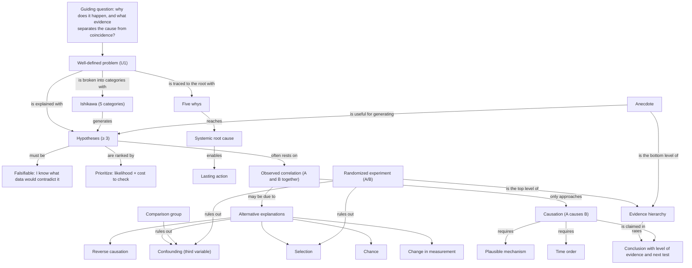

# 05 · Unit Concept Map

**Id:** `s0-c2-u2-mapa` · **Format:** concept map (diagram + text description) and a building activity · **Time:** approx. 25 min [INFERENCE] · **Assessment:** ungraded; self-check against the reference map.

**Why:** studying with concept maps, and especially building them, was associated with better retention and transfer than other ways of studying in a meta-analysis of 55 studies [VERIFIED: Nesbit and Adesope 2006, https://www.sfu.ca/~jcnesbit/research/nesbitadesope2006.htm]. Combining words and images takes advantage of both processing channels [VERIFIED: Mayer's principles, https://fbe.unimelb.edu.au/wcla/resources/blended-and-online-learning/multimedia-learning-theory-mlt].

## 1. Activity: build your own map first (15 min)

Before looking at the reference map, build yours on paper or in a tool, whichever you prefer.

**Concepts** (use all of them):
well-defined problem · hypothesis · falsifiable · prioritize (likelihood × cost) · five whys · Ishikawa · root cause · lasting action · correlation · causation · reverse causation · confounding · selection · chance · change in measurement · mechanism · time order · comparison group · randomized experiment (A/B) · evidence hierarchy · anecdote · conclusion with level of evidence

**Rules:**
1. Every arrow carries a **verb or linking phrase** ("generates," "is tested with," "may be due to"…). An unlabeled arrow doesn't count.
2. The guiding question goes at the top: *why does the problem happen, and what evidence separates the cause from coincidence?*
3. Mark with ★ the **two** relationships you found hardest.

## 2. Reference map

## 3. Text description of the map (for screen readers and for anyone who prefers text)

The map reads top to bottom and has three branches coming out of the **well-defined problem**, which comes from U1.

1. **Hypothesis branch.** The problem is explained with **hypotheses**, at least three. Each hypothesis must be **falsifiable**: you know what data would contradict it. Hypotheses are ranked by their **likelihood and their cost to check**. The **Ishikawa diagram** generates hypotheses by category, and **anecdotes** are also useful for generating them.
2. **Root-cause branch.** The **five whys** lead from the problem to a **systemic root cause**, and that cause enables a **lasting action**.
3. **Evidence branch.** Many hypotheses rest on a **correlation**: A and B appear together. A correlation may be due to five **alternative explanations**: reverse causation, confounding, selection, chance or a change in measurement. Correlation only approaches **causation**, which requires a plausible **mechanism** and the correct **time order**. A **comparison group** helps rule out confounding, and a **randomized experiment** also rules out selection. The experiment is the top level of the **evidence hierarchy** and the anecdote is the bottom. That hierarchy rates the **conclusion**, which always states its level of evidence and the next test.

## 4. Self-check (10 min)

Compare your map with the reference:
- [ ] Did you connect the **anecdote** to "generating hypotheses" and not to "confirming"?
- [ ] Do your five alternatives hang from the **correlation**, not from causation?
- [ ] Did you write that **Ishikawa generates hypotheses**, instead of "finds the cause"?
- [ ] Is there a relationship of yours that **isn't** in the reference and is correct? Write it down: maps don't have a single valid version.
- [ ] Look at your two ★: which section of the guide do you need to reread for each?

**Note for visual production:** Arkano decides how the map looks. Pedagogically, arrow labels must sit **on** the arrows, not in a separate legend, and color must not be the only way to tell the branches apart (`marco-pedagogico.md`, section 5, rules 6 and 13).
