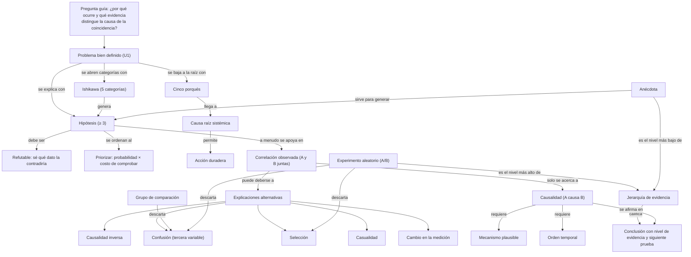

# 05 · Mapa conceptual de la unidad

**Id:** `s0-c2-u2-mapa` · **Formato:** mapa conceptual (diagrama + descripción textual) y actividad de construcción · **Tiempo:** ≈ 25 min  · **Evaluación:** sin nota; autocorrección con el mapa de referencia.

**Por qué:** estudiar con mapas conceptuales, y sobre todo construirlos, se asoció con mejor retención y transferencia que otras formas de estudio en una metaanálisis de 55 estudios (Nesbit y Adesope 2006, https://www.sfu.ca/~jcnesbit/research/nesbitadesope2006.htm). Combinar palabras e imagen aprovecha los dos canales de procesamiento (principios de Mayer, https://fbe.unimelb.edu.au/wcla/resources/blended-and-online-learning/multimedia-learning-theory-mlt).

## 1. Actividad: construye tu mapa primero (15 min)

Antes de mirar el mapa de referencia, construye el tuyo en papel o en una herramienta, como prefieras.

**Conceptos** (usa todos):
problema bien definido · hipótesis · refutable · priorizar (probabilidad × costo) · cinco porqués · Ishikawa · causa raíz · acción duradera · correlación · causalidad · causalidad inversa · confusión · selección · casualidad · cambio en la medición · mecanismo · orden temporal · grupo de comparación · experimento aleatorio (A/B) · jerarquía de evidencia · anécdota · conclusión con nivel de evidencia

**Reglas:**
1. Cada flecha lleva un **verbo o una frase de enlace** ("genera", "se pone a prueba con", "puede deberse a"…). Una flecha sin rótulo no cuenta.
2. Arriba va la pregunta guía: *¿por qué ocurre el problema y qué evidencia distingue la causa de la coincidencia?*
3. Marca con ★ las **dos** relaciones que más te costaron.

## 2. Mapa de referencia

## 3. Descripción textual del mapa (para lectores de pantalla y para quien prefiera texto)

El mapa se lee de arriba hacia abajo y tiene tres ramas que salen del **problema bien definido**, que viene de la U1.

1. **Rama de las hipótesis.** El problema se explica con **hipótesis**, al menos tres. Cada hipótesis debe ser **refutable**: sabes qué dato la contradiría. Las hipótesis se ordenan según su **probabilidad y su costo de comprobación**. El **diagrama de Ishikawa** genera hipótesis por categorías, y las **anécdotas** también sirven para generarlas.
2. **Rama de la causa raíz.** Los **cinco porqués** llevan desde el problema hasta una **causa raíz sistémica**, y esa causa permite una **acción duradera**.
3. **Rama de la evidencia.** Muchas hipótesis se apoyan en una **correlación**: A y B aparecen juntas. Una correlación puede deberse a cinco **explicaciones alternativas**: causalidad inversa, confusión, selección, casualidad o cambio en la medición. La correlación solo se acerca a la **causalidad**, que requiere un **mecanismo** plausible y un **orden temporal** correcto. Un **grupo de comparación** ayuda a descartar la confusión, y un **experimento aleatorio** descarta además la selección. El experimento es el nivel más alto de la **jerarquía de evidencia** y la anécdota, el más bajo. Esa jerarquía califica la **conclusión**, que siempre declara su nivel de evidencia y la siguiente prueba.

## 4. Autocorrección (10 min)

Compara tu mapa con el de referencia:
- [ ] ¿Conectaste la **anécdota** con "generar hipótesis" y no con "confirmar"?
- [ ] ¿Tus cinco alternativas cuelgan de la **correlación**, y no de la causalidad?
- [ ] ¿Pusiste que **Ishikawa genera hipótesis**, en lugar de que "encuentra la causa"?
- [ ] ¿Hay alguna relación tuya que **no está** en la referencia y que sea correcta? Anótala: los mapas no tienen una única versión válida.
- [ ] Mira tus dos ★: ¿qué sección de la guía tienes que releer para cada una?

**Nota para la producción visual:** Las etiquetas de las flechas deben ir **sobre** las flechas, no en una leyenda aparte, y el color no debe ser la única forma de distinguir las ramas.
